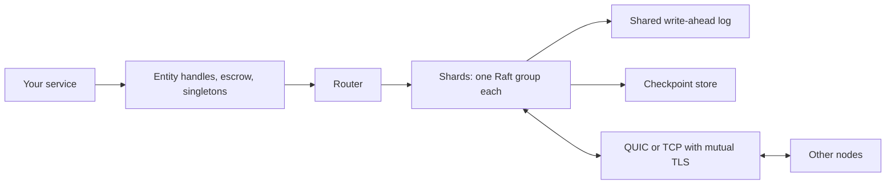

# Architecture

## An embedded cluster

Most replicated stores run as a separate service that your application calls over the network. Quorium is a library instead: each instance of your service is a node of the cluster. There is no separate database to deploy, and your state types and their write methods are compiled into your binary.

This shapes the rest of the design:

- **State is Rust types.** A write is a method call, replicated as a log entry naming the method and its arguments. Every replica runs the same method on the same state in the same order, so it reaches the same result. This is why writes must be deterministic and why they receive time and randomness through `Ctx`.
- **The cluster follows your deployment.** Instances find each other through discovery, extra instances become standby learners, and a lost instance is replaced automatically. Nobody runs membership commands.
- **Reads are local.** The state lives in the memory of every node. A linearizable read only needs to confirm that the local replica is current, not to fetch the data.

## Layers

| Layer | Crate | Responsibility |
|---|---|---|
| API | `quorium` | Builder, entity handles, escrow, singletons, discovery, membership, routing, backups, metrics |
| Macros | `quorium-macros` | Turn a struct and its `impl` block into a registered state type and a typed handle |
| State machine | `quorium-core` | The replicated key-value and entity state, client sessions, the Ladder election controller, the entity registry |
| Storage | `quorium-store` | The shared write-ahead log and the checkpoint stores (redb, fjall) |
| Network | `quorium-net` | The versioned message codec, QUIC and TCP transports with mutual TLS |
| Consensus | [openraft](https://github.com/databendlabs/openraft) | Raft: log replication, terms, votes, snapshots |
| Simulation | `quorium-sim` | A deterministic runtime, network and disk for testing all of the above |

Quorium builds on openraft for the core consensus algorithm and adds what an embedded cluster needs around it: its own election timing (the [Ladder](ladder.md)), storage shared by many Raft groups, membership automation, sharding and escrow.

## Inside one node

## Shards are Raft groups

Each shard is an independent Raft group with its own leader and log. Every voter holds a replica of every shard, and leadership is spread across voters, so the write load is spread too. All shards on a node share one write-ahead log and one fsync, so many shards cost little more disk I/O than one. See [Sharding and placement](sharding.md).

A separate small group, the meta group, holds the routing table that maps key ranges to shards.

## Membership

Membership is automatic:

- A node that starts finds peers through discovery. If no cluster exists yet, it waits until `replicas` seeds are reachable, and only the seed with the lowest node ID creates the cluster. Two clusters can therefore never form from the same seeds.
- A node that finds an existing cluster joins as a **learner**: it receives the log but does not vote.
- While there are fewer voters than `replicas`, the leader promotes caught-up learners.
- A voter that stays unreachable for `replacement_grace` is replaced by a caught-up learner. The number of voters never drops below `replicas`; without a learner, a dead voter stays.

A node's identity is the random ID stored in its data directory. A node with a wiped disk is a new node.

## Talking between nodes

Nodes talk over QUIC (or TCP) with mutual TLS. Each message is a versioned envelope, so nodes running different releases can exchange messages during a rolling upgrade. Besides Raft traffic, nodes exchange liveness pings that measure round trips and log positions; the Ladder uses them to time elections.

## Upgrades

During a rolling upgrade, old and new binaries replicate the same log. A write method that only the new binary knows could be applied by some replicas and rejected by others. To prevent this, each node advertises the methods it knows, and a method is enabled only once every voter of its shard advertises it.
