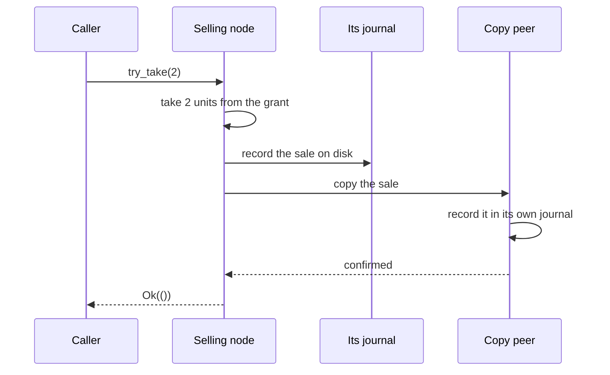

# How escrow works

## The problem

Selling from a limited stock is easy on one machine: check the count, decrement it. In a replicated system, every decrement must go through consensus, or two nodes could both sell the last unit. A consensus round trip per sale caps throughput at what one leader can commit, and adds cross-region latency to every sale.

## Splitting the stock

Escrow divides the stock instead of locking it. The cluster's state holds a **pool** of unsold units. A node that wants to sell asks for a **grant**: units moved out of the pool, through consensus, into that node's hands. The node then sells from its grant locally, with no network round trip. Since the grants and the pool never overlap, the sum of all sales can never exceed the stock.

Nodes report their sales back to the cluster in the background (settlement), and release unused units after 2 seconds without sales. Grants shrink as the stock runs low, so the last units are not stuck on one idle node. When a node's grant is empty and the pool cannot fill it, the sale goes through consensus directly, so the last unit can always be sold.

## Making local sales durable

A sale acknowledged to a client must survive the crash of the node that made it. Otherwise, after a restart, the node would not know it had sold those units, and could sell them again.

So, before `try_take` returns:

1. The sale is written to the node's escrow journal on disk.
2. It is copied to a **copy peer**: another live node in the same datacenter, chosen when the grant was made. The peer writes it to its own journal.

If the peer does not confirm, the sale is undone and `try_take` returns `Unavailable`. A node with no live peer in its datacenter does not hold grants at all; it sells through consensus.

The copy peer is in the same datacenter so that the copy costs a local round trip, not a cross-region one.

## When a node is removed

If a node is removed from the cluster while holding a grant, its unsold units must go back to the pool, but its sales must not be lost. Its copy peer handles this:

1. The peer stops accepting copies from the removed node. Even if the removed node is still running somewhere, it can no longer complete a sale.
2. The peer settles every sale it recorded for the removed node.
3. It returns the rest of the grant to the pool.

If the copy peer was removed too, nobody knows how much of the grant was sold, so the whole grant is counted as sold. Units can be lost that way, but never sold twice.

## Safety over completeness

Every choice above favours never overselling over selling everything. When information is missing, units are counted as sold. The result is that a counter can, in rare failure cases, stop short of its full stock. One such case remains open in this release; see [Known limitations](limitations.md).
